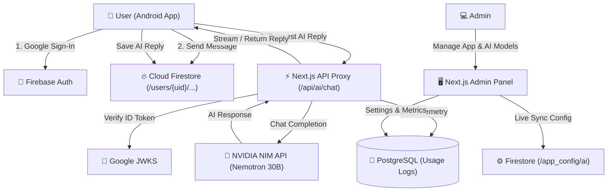

# 🌸 Anjali AI — Open Source Conversational Companion

[](https://opensource.org/licenses/MIT)
[](https://developer.android.com/jetpack/compose)
[](https://nextjs.org/)
[](https://build.nvidia.com)
[](https://firebase.google.com)

**Anjali AI** is a complete, production-ready, open-source conversational companion platform. It features a modern native **Android app** built with Jetpack Compose and Material 3, paired with a full-stack **Next.js 15 Admin Dashboard** powered by PostgreSQL and Cloud Firestore.

Designed for natural, warm, and playful conversations in **Hinglish, Hindi, and English**, Anjali feels like texting a real bestie rather than interacting with a sterile chatbot.

---

## 🏗️ Architecture Overview



---

## 📁 Repository Structure

```
anjali-ai-companion/
├── app/                  # Native Android Companion App (Kotlin + Jetpack Compose)
│   ├── src/main/java/    # Clean MVVM Architecture, Repositories, ViewModels, UI
│   ├── src/main/res/     # Resources, themes, colors, and layout configs
│   ├── build.gradle.kts  # Android app dependencies and signing config
│   └── google-services.json.example  # Template for Firebase Android configuration
├── admin-dashboard/      # Next.js 15 Admin Dashboard & API Proxy
│   ├── src/app/          # App Router: /login, /ai-config, /personality, /usage
│   ├── src/lib/          # Server utilities, NVIDIA client, Firebase JWT verifier
│   ├── src/db/           # Drizzle ORM schema, migrations, and PostgreSQL connection
│   └── package.json      # Dependencies and build scripts
├── .github/workflows/    # CI/CD: Automated Android APK build & GitHub Release
├── firestore.rules       # Hardened per-user Cloud Firestore security rules
├── .env.example          # Environment variables template
└── LICENSE               # MIT License
```

---

## 🚀 Step-by-Step Setup Guide

### 1. Firebase Project Setup
1. Go to the [Firebase Console](https://console.firebase.google.com/) and create a new project.
2. In **Build → Authentication**, enable **Google Sign-In**.
3. In **Build → Firestore Database**, create a Firestore database (start in production or test mode).
4. Apply the included security rules:
   * Copy the contents of [`firestore.rules`](./firestore.rules) into **Firestore Database → Rules** and click **Publish**.
5. Add an **Android App** to your Firebase project:
   * Package name: `com.anjaliai.companion` (or your custom application ID).
   * Download `google-services.json` and place it in the `app/` folder (replacing `google-services.json.example`).
6. In **Project Settings → Service Accounts**, click **Generate new private key** to download your service account JSON.

---

### 2. PostgreSQL Database Setup
1. Create a free PostgreSQL instance on [Neon](https://neon.tech), [Supabase](https://supabase.com), or AWS RDS.
2. Copy your connection connection string (e.g., `postgresql://...`).

---

### 3. NVIDIA AI API Key
1. Sign up at [NVIDIA NIM / Build](https://build.nvidia.com).
2. Generate an API key starting with `nvapi-...`.
3. Default recommended model: `nvidia/nemotron-3.5-lightning-30b-a3b` or `google/gemma-4-31b-it`.

---

### 4. Admin Dashboard Deployment

```bash
cd admin-dashboard
cp ../.env.example .env
```

Fill in your `.env` variables:
* `DATABASE_URL`: Your PostgreSQL connection string.
* `ADMIN_SESSION_SECRET`: A secure 32+ character random secret (`openssl rand -base64 32`).
* `ADMIN_EMAILS`: Your Google email address (e.g. `yourname@gmail.com`).
* `NVIDIA_API_KEY`: Your NVIDIA API key (`nvapi-...`).
* `FIREBASE_PROJECT_ID`: Your Firebase project ID.
* `FIREBASE_SERVICE_ACCOUNT_KEY`: Base64-encoded string of your service account JSON.

Install dependencies and run migrations:
```bash
npm install
npm run db:push
npm run dev
```
Visit `http://localhost:3000` to configure Anjali's personality, AI models, and sync settings to Firestore.

---

### 5. Building the Android App

#### In Android Studio:
1. Open the root `anjali-ai-companion` folder in **Android Studio Meerkat / Ladybug** or newer.
2. Ensure `app/google-services.json` is present with your Firebase project credentials.
3. Sync Gradle and click **Run** (or select **Build → Build Bundle(s) / APK(s) → Build APK(s)**).

#### Via Command Line:
```bash
chmod +x gradlew
./gradlew assembleDebug
```
The compiled APK will be at: `app/build/outputs/apk/debug/app-debug.apk`.

#### Automated GitHub Actions CI:
Push your code or trigger the **Build & Release Android APK** workflow under **Actions** in GitHub. It automatically builds the APK and publishes it to GitHub Releases.

---

## 🔒 Security & Privacy

* **Strict Per-User Data Isolation:** Conversations, messages, and memories are secured via Firestore rules under `/users/{userId}/...` and can only be read or written by the authenticated owner.
* **Server-Side API Keys:** End-user Android devices never need hardcoded server secrets. All AI completions can route securely through the authenticated Next.js proxy (`/api/ai/chat`).
* **Zero Secret Leakage:** Git history is kept 100% clean of all API keys, service accounts, and sensitive credentials.

---

## 🤝 Contributing

Contributions are welcome! Please feel free to submit a Pull Request or open an Issue.

1. Fork the Project
2. Create your Feature Branch (`git checkout -b feature/AmazingFeature`)
3. Commit your Changes (`git commit -m 'Add some AmazingFeature'`)
4. Push to the Branch (`git push origin feature/AmazingFeature`)
5. Open a Pull Request

---

## 📄 License

Distributed under the MIT License. See [`LICENSE`](./LICENSE) for more information.
